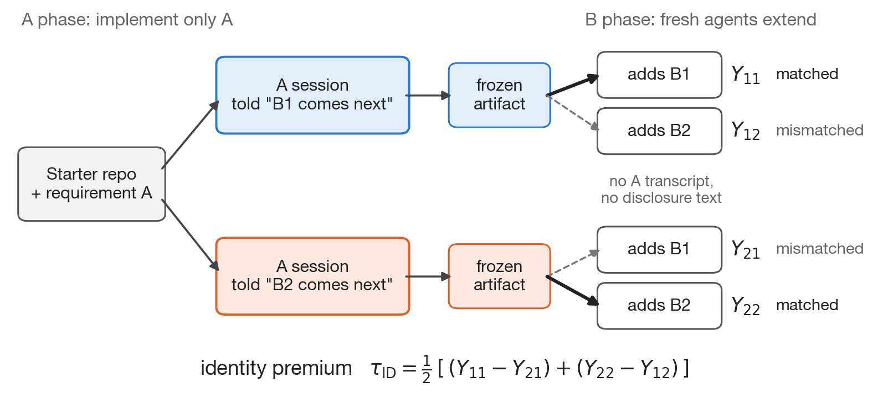
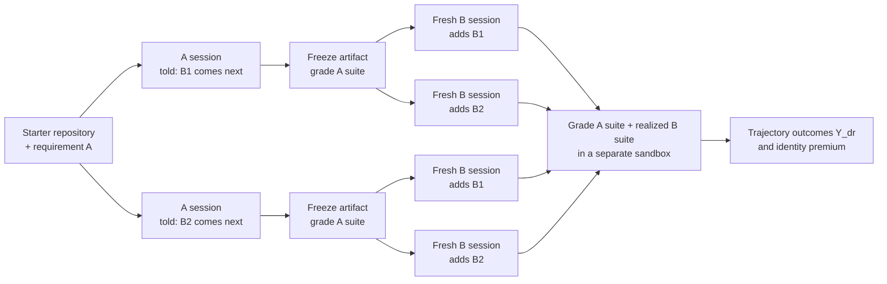
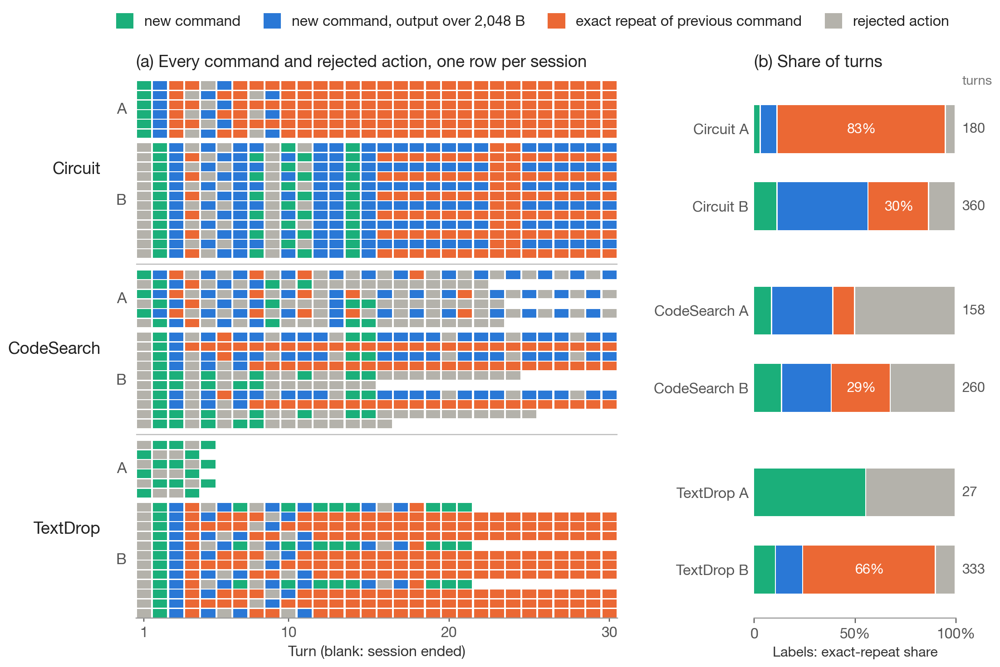
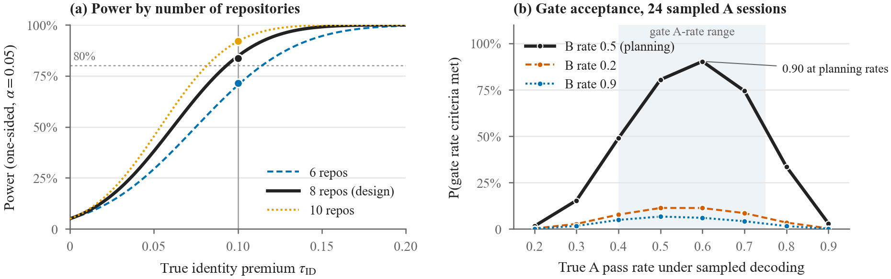

# FUSE: telling coding agents what comes next

[](https://github.com/ceyhunolcan/fuse/actions/workflows/tests.yml)
[](LICENSE)


[](https://www.kaggle.com/competitions/gemma-4-developer-agent-paper/writeups/new-writeup-1791405149695)
[](https://www.kaggle.com/datasets/ceyhunolcan/fuse-reproducibility-package-zip)

**Does telling a coding agent which requirement comes next, while instructing it to implement only the current one, make its code easier for a fresh agent to extend in that direction?**

FUSE (Future-conditioned Software Evolution) answers this with a *disclosure crossover*. This repository contains the agent harness used in the preliminary study, the three tasks that study ran, and two mined development triples. It is a development release: the tasks build and check the method, and the confirmatory study is planned as a registered report.

**Paper:** [Heads-Up Before the Handoff: Telling Gemma 4 Coding Agents What Comes Next](https://www.kaggle.com/competitions/gemma-4-developer-agent-paper/writeups/new-writeup-1791405149695) (Kaggle Gemma 4 Developer Agent Paper Track, 2026) · **Evidence:** [reproducibility package](https://www.kaggle.com/datasets/ceyhunolcan/fuse-reproducibility-package-zip) · **Dataset:** [`ceyhunolcan/fuse`](https://huggingface.co/datasets/ceyhunolcan/fuse) on HuggingFace

> **Key findings of the preliminary study** (`gemma-4-31b-it-qat-w4a16-ct`, three tasks, 51 sessions)
> - None of the 51 completed sessions passed its full hidden suite, so the identity premium τ_ID could not be estimated.
> - The interface got in the way: 86% of command outputs were cut at the 2,048-byte limit, and 43% of turns exactly repeated the previous command.
> - In a pre-registered rerun, doubling the limit to 4,096 bytes took Circuit from 0 of 2 to 2 of 2 passing sessions (one run per prompt; not a general causal estimate).

**Contents:** [Design](#the-design) · [What is included](#what-is-included) · [Quick start](#quick-start) · [How a run works](#how-a-run-works) · [Preliminary study](#preliminary-study) · [Planned confirmatory study](#planned-confirmatory-study) · [Repository layout](#repository-layout) · [Citation](#licence-and-citation)

## The design

Each task pairs a current change **A** with two alternative later changes, **B1** and **B2**. Two A agents receive the same task, but one is told that B1 comes next and the other that B2 comes next. Each frozen A repository is then extended by two fresh B agents, one per future. The B agents never see the A transcript or the disclosure.



The **identity premium** compares handoffs whose disclosure matched the future that arrived with handoffs whose disclosure did not, holding the realized future fixed:

$$\tau_{\mathrm{ID}} = \tfrac{1}{2}\big[(Y_{11} - Y_{21}) + (Y_{22} - Y_{12})\big]$$

where $Y_{dr} = 1$ when the A artifact passes its hidden A suite and the extended artifact passes both the A suite and the hidden suite of the realized future $r$, after future $d$ was disclosed. Because each contrast holds the realized future fixed, differences in how hard B1 and B2 are cancel out. $\tau_{\mathrm{ID}} > 0$ means that hearing about the right future helps the handoff.

## What is included

| | |
|---|---|
| Authored study tasks | 3 (Circuit, CodeSearch, TextDrop), each with 3 hidden suites: **71 hidden tests** in total |
| Mined development triples | 2 (Starlette, Strix), with ports, fixture checks and dependency checks |
| Agent harness | The study's agent loop, Docker sandbox, grading and τ_ID estimator |
| Model access | Any OpenAI-compatible chat-completions endpoint |
| Unit tests | 184, running on Python 3.12 with no extra packages |
| Dataset | The same five tasks on HuggingFace as [`ceyhunolcan/fuse`](https://huggingface.co/datasets/ceyhunolcan/fuse), in subsets `authored` and `mined` (split `development`) |

### Authored tasks

Number of hidden tests per suite in parentheses.

| Task | Current requirement A | Future B1 | Future B2 |
|---|---|---|---|
| `circuit_001` | Bit-vector circuit evaluator (10) | Three-valued logic with `X` (5) | JSON and BENCH input formats (7) |
| `codesearch_001` | Exact token search over Python and JavaScript (9) | Structural patterns with metavariables (10) | Search-and-replace with diffs (5) |
| `textdrop_001` | Note-store CLI with Markdown rendering and export (10) | Accounts and note ownership (8) | Journal storage backend (7) |

Each task also has a starter repository, reference solutions for A, B1 and B2, leakage probes and a written scope boundary that separates permitted generic preparation from future-specific code. The task families are adapted from [SlopCodeBench](https://github.com/gabeorlanski/scb-problems); everything in `benchmark/tasks` was written for FUSE.

### Mined development triples

| Repository | A | B1 | B2 | Fail-to-pass tests (A / B1 / B2) | Regression tests | Status |
|---|---|---|---|---|---|---|
| [Kludex/starlette](https://github.com/Kludex/starlette) | [#3418](https://github.com/Kludex/starlette/pull/3418) | [#3421](https://github.com/Kludex/starlette/pull/3421) | [#3420](https://github.com/Kludex/starlette/pull/3420) | 14 / 10 / 2 | 983 | Validates the pipeline; not eligible (B2 does not build on A) |
| [usestrix/strix](https://github.com/usestrix/strix) | [#733](https://github.com/usestrix/strix/pull/733) | [#1496](https://github.com/usestrix/strix/pull/1496) | [#1550](https://github.com/usestrix/strix/pull/1550) | 7 / 2 / 1 | 142 | Fully eligible (both Bs rewrite lines A wrote) |

All fixture checks passed identically in three repeats. Both repositories are reserved for development and will never enter the confirmatory task set. Details, ports and logs are in [`mining/`](mining/).

## Quick start

Checking the tasks needs only Python 3.12 and Git:

```sh
git clone https://github.com/ceyhunolcan/fuse.git && cd fuse
python3 -m unittest discover -s tests -t .
python3 -m runner.cli validate --task circuit_001
```

`validate` confirms that the starter fails the A suite, each reference passes its own suites and fails the other future's, and the leakage probes behave as expected.

Running a model also needs Docker:

```sh
docker build -t fuse-sandbox -f docker/sandbox.Dockerfile docker/
docker images --no-trunc --format '{{.ID}}' fuse-sandbox     # image ID for the config
cp configs/openai_compatible.example.json my-config.json        # set model, endpoint_url, container_image
export FUSE_API_KEY=...
python3 -m runner.cli smoke-model --config my-config.json --task circuit_001 --output runs/circuit-1 --no-parquet
```

The main config fields:

| Field | Meaning | Example value |
|---|---|---|
| `endpoint_url` | Base URL of an OpenAI-compatible API, ending in `/v1` | `https://api.openai.com/v1` |
| `model`, `model_revision` | Model name sent to the endpoint, and a version recorded with each run | your model |
| `api_key_env` | Environment variable holding the API key (never written to records) | `FUSE_API_KEY` |
| `temperature` | Sampling temperature | `0.0` |
| `max_turns`, `time_limit_seconds` | Per-phase turn and time budget | `30`, `900` |
| `context_budget_tokens`, `max_generated_tokens`, `max_output_tokens_per_turn` | Token budgets per phase | `32768`, `32768`, `8192` |
| `container_image` | Sandbox image ID from `docker images` | `sha256:…` |

See [docs/running-a-model.md](docs/running-a-model.md) for the full guide, including how to match the study's settings.

## How a run works

One `smoke-model` run performs one block of the crossover for one task:



Agents act through one JSON action per turn: `{"action":"run_command","command":"…"}` runs a shell command in `/workspace` inside a container with no network, and `{"action":"submit_patch"}` ends the phase. Each phase has fixed turn, time and token budgets, and every phase is graded only after the agent has stopped. Records are written to `raw/`, `sessions/`, `artifacts/` and `summary.json` in the output folder.

## Preliminary study

The preliminary study ran `gemma-4-31b-it-qat-w4a16-ct` on four Kaggle L4 GPUs with greedy decoding and a 2,048-byte limit on model-visible tool output. Prompts, budgets, assignments, stopping rules and analysis were hash-pinned before any data were collected.

**Primary outcome.** None of the 51 completed sessions passed its full hidden suite, so no trajectory succeeded and τ_ID was not identified:

| Task | Trajectories (known / missing) | Successes | τ_ID | Missing-outcome bounds |
|---|---|---|---|---|
| Circuit | 12 / 0 | 0 | 0 | [0, 0] |
| CodeSearch | 10 / 2 | 0 | undefined | [−0.17, +0.17] |
| TextDrop | 12 / 0 | 0 | 0 | [0, 0] |
| Equal-weight average | | | undefined | [−0.06, +0.06] |

**Why the agents failed.** All three starter files exceeded the 2,048-byte limit, 86% of command outputs were cut, and at temperature 0 agents often reissued the same command:



| Task, phase | Turns | Output over limit | Exact repeats | Rejected actions |
|---|---|---|---|---|
| Circuit A | 180 | 96% | 83% | 5% |
| Circuit B | 360 | 87% | 30% | 13% |
| CodeSearch A | 158 | 82% | 11% | 50% |
| CodeSearch B | 260 | 80% | 29% | 32% |
| TextDrop A | 27 | 0% | 0% | 44% |
| TextDrop B | 333 | 88% | 66% | 10% |
| **All** | **1,318** | **86%** | **43%** | **20%** |

Of 265 rejected actions, 117 were invalid JSON escapes (regular expressions written into files through JSON strings), 76 used Gemma's native tool-call syntax and 35 were cut at the per-turn token limit. TextDrop agents created a new package that shadowed the working starter module.

**Two pre-registered reruns.** Both reran the six block-1 A prompts byte for byte. Hidden A tests passed:

| Task, disclosure | 2,048 B (main stage) | 4,096 B (C1) | 4,096 B + interface repairs (C2) |
|---|---|---|---|
| Circuit, B1 | 6/10 | **10/10** | 5/10 |
| Circuit, B2 | 6/10 | **10/10** | **10/10** |
| CodeSearch, B1 | 3/9 | 0/9 | 8/9 |
| CodeSearch, B2 | 0/9 | 0/9 | **9/9** |
| TextDrop, B1 | 0/10 | 0/10 | 0/10 |
| TextDrop, B2 | 1/10 | 0/10 | 1/10 |
| Repeated / rejected turns | 46% / 28% | 0% / 60% | 7% / 16% |

A larger output limit was enough for both Circuit prompts to pass (one run each, in a separate launch; not a general causal estimate). The interface repairs cut rejected turns from 60% to 16% but did not raise the number of passing sessions. The disclosure changed the code agents wrote in two of three tasks in the main stage and in all three in the reruns; whether it steers that code toward the disclosed future is untested.

The [paper](https://www.kaggle.com/competitions/gemma-4-developer-agent-paper/writeups/new-writeup-1791405149695) and the sealed evidence, with a script that recomputes every result above, are public: see the [reproducibility package on Kaggle](https://www.kaggle.com/datasets/ceyhunolcan/fuse-reproducibility-package-zip).

## Planned confirmatory study

The confirmatory study is proposed as a registered report: the design and analysis are reviewed before any outcome is collected.

| | |
|---|---|
| Tasks | 16 mined triples, two from each of eight repositories, all merged on or after 6 June 2026 |
| Arms | A told B1, told B2, or told nothing |
| Sessions | 16 tasks × 8 blocks × 9 sessions = 1,152 |
| Primary test | One-sided t-test of τ_ID on repository means; equivalence margin ±0.10 |
| Planned power | 0.84 at τ_ID = 0.10 (simulation); null false-positive rate 0.053 |
| Before collection | An interface gate on separate development tasks, then a frozen, timestamped protocol |



*(a) Power of the repository-mean t-test by true identity premium, for 6, 8 (planned) or 10 repositories. (b) Probability that the development gate's rate criteria accept a configuration, by its true A and B pass rates.*

## Repository layout

| Path | What it is |
|---|---|
| `runner/` | Agent loop (`agent.py`), phases A and B, Docker sandbox, freezing, CLI |
| `evaluator/` | Hidden-suite grading, leakage probes, grading policy |
| `analysis/` | τ_ID estimator with missing-outcome bounds, and analysis helpers |
| `prompts/` | System prompt and the A and B phase prompts |
| `benchmark/tasks/` | The three authored tasks |
| `mining/` | Mined development triples, the line-provenance scan and the mining screen |
| `configs/`, `docker/` | Example config for OpenAI-compatible endpoints, and the sandbox image |
| `scripts/build_hf_dataset.py` | Builds the HuggingFace development split from this repository |
| `docs/` | Model-run guide, the HuggingFace dataset card and figures |
| `tests/` | Unit tests |

## Relationship to the study

`runner/agent.py` is byte-identical to the version the study pinned by hash. The study ran on Kaggle GPUs through a separate runner that wraps this loop; that runner and the sealed evidence are archived in the reproducibility package. [CHANGES.md](CHANGES.md) lists every difference between this repository and the pinned harness.

## Licence and citation

Apache-2.0 ([LICENSE](LICENSE)). The task families are adapted from SlopCodeBench (Apache-2.0). The mined triples include code and tests from Starlette (BSD-3-Clause) and Strix (Apache-2.0), which keep their licences; see [NOTICE](NOTICE).

```bibtex
@misc{olcan2026fuse,
  author       = {Olcan, Ceyhun},
  title        = {Heads-Up Before the Handoff: Telling {Gemma} 4 Coding Agents What Comes Next},
  year         = {2026},
  howpublished = {Kaggle Gemma 4 Developer Agent Paper Track},
  url          = {https://www.kaggle.com/competitions/gemma-4-developer-agent-paper/writeups/new-writeup-1791405149695}
}
```

The evidence and reproduction materials are at the [Kaggle dataset](https://www.kaggle.com/datasets/ceyhunolcan/fuse-reproducibility-package-zip). See also [CITATION.cff](CITATION.cff); a DOI for this software is added with the first archived release.
