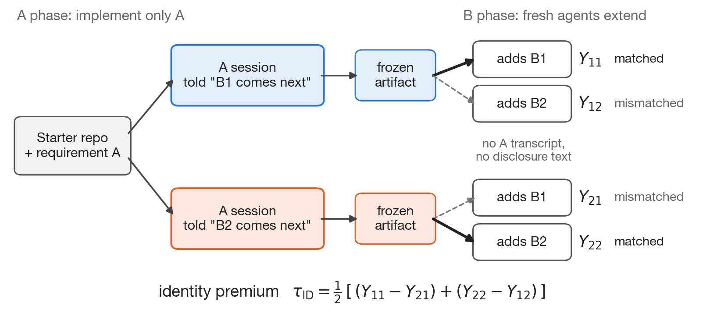

# FUSE development tasks

**Does telling a coding agent which requirement comes next, while instructing it to implement only the current one, make its code easier for a fresh agent to extend in that direction?**

FUSE (Future-conditioned Software Evolution) studies this with a *disclosure crossover*. Each task pairs a current change **A** with two alternative later changes, **B1** and **B2**. Two agents implement A after being told different futures; fresh agents, who never see the disclosure, then extend each result toward both futures.



The **identity premium** compares matched with mismatched handoffs while holding the realized future fixed:

$$\tau_{\mathrm{ID}} = \tfrac{1}{2}\big[(Y_{11} - Y_{21}) + (Y_{22} - Y_{12})\big]$$

where $Y_{dr} = 1$ when, after future $d$ was disclosed, the A artifact passes its hidden A suite and the extended artifact passes the A suite and the realized future's suite.

This is a **development release**: five tasks used to build and check the method. It is not a leaderboard, and none of these tasks belongs to the confirmatory set of the planned registered report, which will be mined from other repositories.

## Quick start

```python
from datasets import load_dataset

authored = load_dataset("ceyhunolcan/fuse", "authored", split="development")   # 3 study tasks
mined = load_dataset("ceyhunolcan/fuse", "mined", split="development")         # 2 mined triples

task = authored[0]
print(task["task"], task["num_tests_A"], task["num_tests_B1"], task["num_tests_B2"])
print(task["requirement_A"][:300])
```

To run agents on the authored tasks, use the harness at [github.com/ceyhunolcan/fuse](https://github.com/ceyhunolcan/fuse). It works with any OpenAI-compatible chat-completions endpoint, runs agent commands in a Docker container without network access, grades each phase with the hidden suites and computes τ_ID.

## Subsets

| Subset | Rows | What a row is |
|---|---|---|
| `authored` (default) | 3 | A task written for FUSE: requirements, disclosures, starter repository, reference solutions, hidden suites and scope boundary |
| `mined` | 2 | A triple of merged pull requests from a public repository: snapshot commit, patches, test files and test IDs |

### Authored tasks

Number of hidden tests per suite in parentheses.

| `task` | Current requirement A | Future B1 | Future B2 |
|---|---|---|---|
| `circuit_001` | Bit-vector circuit evaluator (10) | Three-valued logic with `X` (5) | JSON and BENCH input formats (7) |
| `codesearch_001` | Exact token search over Python and JavaScript (9) | Structural patterns with metavariables (10) | Search-and-replace with diffs (5) |
| `textdrop_001` | Note-store CLI with Markdown rendering and export (10) | Accounts and note ownership (8) | Journal storage backend (7) |

All three were run in the preliminary Gemma 4 study, with their suites sealed before any outcome existed.

### Mined triples

| `instance_id` | Repository | A → B1, B2 | Fail-to-pass (A / B1 / B2) | Regression tests | Status |
|---|---|---|---|---|---|
| `fuse-dev/starlette-3418` | [Kludex/starlette](https://github.com/Kludex/starlette) | #3418 → #3421, #3420 | 14 / 10 / 2 | 983 | Validates the pipeline; not eligible (B2 does not build on A) |
| `fuse-dev/strix-733` | [usestrix/strix](https://github.com/usestrix/strix) | #733 → #1496, #1550 | 7 / 2 / 1 | 142 | Fully eligible; B1 and B2 rewrite lines A wrote |

Both were checked by running each repository's tests three times with identical results. Both repositories are reserved for development.

## Fields

File collections are lists of `{"path": ..., "content": ...}` records, with paths relative to the repository root.

### `authored`

| Field | Type | Description |
|---|---|---|
| `instance_id`, `task` | string | Identifier, e.g. `fuse-dev/circuit_001` and `circuit_001` |
| `status`, `source`, `license` | string | Use in the study, provenance and licence |
| `requirement_A` | string | The current requirement given to the A agent |
| `requirement_B1`, `requirement_B2` | string | The full later requirement given to a B agent |
| `disclosure_B1`, `disclosure_B2` | string | The one-paragraph disclosure shown to the A agent |
| `scope_boundary` | string or null | What counts as permitted generic preparation versus future-specific code |
| `starter_files` | list of files | The starting repository |
| `reference_A`, `reference_B1`, `reference_B2` | list of files | Reference solutions after A, A+B1 and A+B2 |
| `tests_A`, `tests_B1`, `tests_B2` | list of files | Hidden test suites |
| `num_tests_A`, `num_tests_B1`, `num_tests_B2` | int | Number of test functions in each suite |

### `mined`

| Field | Type | Description |
|---|---|---|
| `instance_id`, `repository`, `license`, `status` | string | Identifier, upstream repository, its licence and the triple's status |
| `criterion_3` | string | How each B builds on A (lines rewritten, or tests failing without A) |
| `snapshot_commit`, `commit_A`, `commit_B1`, `commit_B2` | string | The snapshot S (first parent of A's merge) and the merge commits |
| `pull_request_A`, `pull_request_B1`, `pull_request_B2` | string | Links to the pull requests |
| `patch_A` | string | Upstream diff from S to A |
| `patch_B1`, `patch_B2` | string | Each B ported onto S+A on its own |
| `patch_B1_upstream`, `patch_B2_upstream` | string | The upstream diffs, for reference |
| `tests_A`, `tests_B1`, `tests_B2` | list of files | The test files that carry each change's fail-to-pass tests |
| `fail_to_pass_A`, `fail_to_pass_B1`, `fail_to_pass_B2` | list of strings | pytest IDs that fail before and pass after each change |
| `pass_to_pass` | list of strings | Regression test IDs on S+A |
| `notes` | string | Porting notes |

## Writing a task to disk

```python
from pathlib import Path
from datasets import load_dataset

def write_files(records, root):
    for f in records:
        path = Path(root) / f["path"]
        path.parent.mkdir(parents=True, exist_ok=True)
        path.write_text(f["content"], encoding="utf-8")

task = load_dataset("ceyhunolcan/fuse", "authored", split="development")[0]
write_files(task["starter_files"], "work/circuit_001/repo")          # what the A agent starts from
write_files(task["tests_A"], "work/circuit_001/hidden/A/tests")      # keep hidden from agents
```

## Intended uses

- Running and comparing coding agents on the FUSE crossover with the released harness.
- Developing interfaces, scaffolds and prompts for coding agents, and studying how disclosed requirements change the code agents write.
- Checking and extending the task-mining pipeline with the two mined triples.

## Out-of-scope uses

- **Leaderboards.** Five development tasks cannot rank models.
- **Showing hidden material to agents.** Hidden suites, reference solutions and the other future must never be visible to an agent being evaluated.
- **Drawing conclusions about disclosure effects from these tasks alone.** The preliminary study did not identify τ_ID; the confirmatory study uses different tasks.

## Limitations

- Three small authored Python tasks and two mined triples, all in Python.
- The authored tasks adapt public task concepts, so models may have seen similar material during training.
- The preliminary study used one model (`gemma-4-31b-it-qat-w4a16-ct`) with greedy decoding; its agents never passed a full suite at the main-stage output limit.
- Requirement texts for the mined triples are not written yet; the pull requests stand in for them.

## Provenance and licences

- The authored tasks adapt task families from [SlopCodeBench](https://github.com/gabeorlanski/scb-problems) (problem repository commit `9cd9ca3a`, Apache-2.0). Requirements, starters, references and tests were rewritten for FUSE; they are not SlopCodeBench problems.
- `fuse-dev/starlette-3418` contains code and tests from Starlette (BSD-3-Clause); `fuse-dev/strix-733` from Strix (Apache-2.0). These keep their upstream licences.
- Everything else is released under Apache-2.0.

## Links

- Code and harness: [github.com/ceyhunolcan/fuse](https://github.com/ceyhunolcan/fuse)
- Paper: [Heads-Up Before the Handoff: Telling Gemma 4 Coding Agents What Comes Next](https://www.kaggle.com/competitions/gemma-4-developer-agent-paper/writeups/new-writeup-1791405149695) (Kaggle Writeup, DOI [10.34740/kaggle/w/117440](https://doi.org/10.34740/kaggle/w/117440))
- Sealed evidence and reproduction script: [kaggle.com/datasets/ceyhunolcan/fuse-reproducibility-package-zip](https://www.kaggle.com/datasets/ceyhunolcan/fuse-reproducibility-package-zip)
- Software archive: [doi.org/10.5281/zenodo.24182004](https://doi.org/10.5281/zenodo.24182004) (Zenodo, all versions)

## Citation

To cite the paper:

```bibtex
@misc{olcan2026fuse,
  author       = {Olcan, Ceyhun},
  title        = {Heads-Up Before the Handoff: Telling {Gemma} 4 Coding Agents What Comes Next},
  year         = {2026},
  howpublished = {Kaggle Gemma 4 Developer Agent Paper Track},
  doi          = {10.34740/kaggle/w/117440},
  url          = {https://www.kaggle.com/competitions/gemma-4-developer-agent-paper/writeups/new-writeup-1791405149695}
}
```

To cite the tasks and harness (version 0.1.0-dev):

```bibtex
@software{olcan2026fuse_software,
  author    = {Olcan, Ceyhun},
  title     = {{FUSE}: development tasks and agent harness},
  year      = {2026},
  publisher = {Zenodo},
  version   = {0.1.0-dev},
  doi       = {10.5281/zenodo.24182005},
  url       = {https://doi.org/10.5281/zenodo.24182005}
}
```
